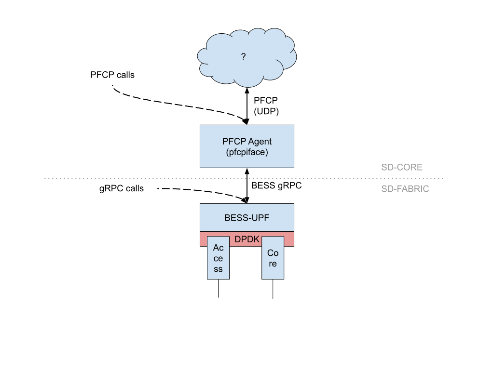
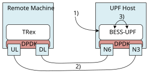

<!-- SPDX-License-Identifier: Apache-2.0 -->
<!-- Copyright 2021 Open Networking Foundation -->
# PTF tests for BESS-UPF

## Overview

The aim of implementing a test framework for UPF is to create a
developer-friendly infrastructure for creating either single-packet or
high-speed tests that assess UPF features at a component level.

This "component-level" is achieved by *bypassing* calls to the PFCP
agent, in favor of communicating with BESS directly via gRPC.



This figure illustrates two options for communicating with the UPF.  In
this framework, we opt for **BESS gRPC calls** instead of calls to the PFCP
agent because they allow direct communication between the framework and
the BESS instance for both installing rules and reading metrics.

## Workflow
Tests require two separate machines to run, since both TRex and UPF
use DPDK. Currently, the test workflow is as such:



In **step 1**, rules are installed onto the UPF instance by the test
framework via BESS gRPC messages.

In **step 2**, TRex or Scapy (depending on the type of test case)
generates traffic to the UPF across NICs and physical links.

In **step 3**, traffic routes through the UPF and back to the machine
hosting TRex, where results are asserted.

## Required Tools/Components
* [PTF](https://github.com/p4lang/PTF) (Packet Testing Framework): a
data plane testing framework written in Python
* [TRex](https://github.com/cisco-system-traffic-generator/trex-core): a
high-speed traffic generator built on top of DPDK, containing a Python API

### TRex and Scapy versions
The PTF image carries the TRex *client* libraries, and the TRex *server* runs
on the traffic-generator host:

* **Client:** Cisco TRex v3.06 (commit
  `46be64bedbe9d505dfb55099c38119d6e86267ca`), downloaded and checked against
  `TREX_ARCHIVE_SHA256` in `ptf/Dockerfile`. Only the stateless (STL) client and
  the daemon client (`trex_stf_lib`) are copied into the image. TRex's bundled
  Scapy is not; PTF and TRex share the single Scapy distribution locked in
  `requirements-ptf.txt` (Scapy 2.8.0).
* **Server:** use a TRex v3.08 release. The client has been run against v3.06
  and v3.08 servers, but the v3.06 server's daemon (`trex_daemon_server`),
  which `ptf_runner.py` uses, fails to start under Python 3.12 or later. Servers from v3.05 on need the
  `ext_dpdk_opt` line in `config/trex-cfg-for-ptf.yaml` on Intel i40e NICs (see
  [Testbed requirements](#testbed-requirements)).

The client is patched at image build time with `ptf/patches/trex/`:

| Patch | Why |
|---|---|
| `0001-stl-use-importlib.patch` | Python 3.14 removed `imp`; the STL stream loader uses `importlib.reload` instead. |
| `0002-use-system-scapy.patch` | Stops TRex putting its bundled Scapy 2.4.3 on `sys.path`, so only the locked Scapy is imported. |
| `0003-use-raw-regex-literals.patch` | Makes regular-expression literals raw, which Python 3.14 otherwise warns about. |
| `0004-stl-calculate-scapy-offsets.patch` | Computes named-field offsets for the field engine (`STLVM`) from serialized packet data instead of the private Scapy field `_offset`, which the locked Scapy doesn't provide. |

`make dependency-smoke` (below) checks the result, including the field offsets
that patch 0004 computes.

## Directory Structure
### config
This directory contains YAML config file definition for TRex along with
other personalized config files
### lib
This directory contains general purpose libraries and classes to be imported in
PTF test definitions
### tests
This directory contains all of the test case definitions (written in Python), as
well as scripts for running them in a test environment. We currently provide two
general types of test cases:
* `unary`: tests are *single packet* tests that assess UPF performance in
specific scenarios. Packets are crafted and sent to the UPF using the `Scapy`
packet library.
  > *Example*: a unary test could use Scapy to send a single non-encapsulated
  UDP packet to the core interface of the UPF, and assert that a
  GTP-encapsulated packet was received from the access interface
* `linerate`: tests assess the UPF's performance in certain scenarios
at high speeds. This allows UPF features to be verified that they perform as
expected in an environment more representative of *production level*. Traffic is
generated using the [TRex Python API](https://github.com/cisco-system-traffic-generator/trex-core/blob/master/doc/trex_cookbook.asciidoc).
  > *Example*: a line rate test could assert the baseline throughput, latency,
  etc. of the UPF is as expected when handling high-speed downlink traffic from
  10,000 unique UEs

## Run tests
The run script assumes that the TRex daemon server and the UPF
instance are already running on their respective machines. Please see
[here](../docs/INSTALL.md#configuration-dpdk-mode) for instructions to deploy
the UPF in DPDK mode. Note that the following additional changes are required
in the `conf/upf.jsonc` file: `"measure_flow": true`, N3 interface set to
`"ifname": "access"` and N6 interface set to `"ifname": "core"`.
To install TRex onto your server, please refer to the
[TRex installation guide](https://trex-tgn.cisco.com/trex/doc/trex_manual.html#_download_and_installation)

### Testbed requirements
* **Two hosts with DPDK-capable NICs**, each with two ports, linked so that
  TRex port 0 connects to the UPF's access (N3) port and TRex port 1 to its
  core (N6) port. Back-to-back cables are simplest. Through a switch, the
  switch's own frames (such as periodic multicast) also reach the TRex
  ports, so tests must count their own streams rather than port totals, as
  the linerate tests do.
* **On both hosts:** IOMMU enabled (`intel_iommu=on iommu=pt`), the test ports
  bound to `vfio-pci`, and hugepages reserved.
* **UPF host:** the UPF in DPDK mode, set up as in
  [`scripts/docker_setup.sh`](../scripts/docker_setup.sh) with the
  `conf/upf.jsonc` changes above. The tests assume `docker_setup.sh`'s addresses:
  N3 `198.18.0.1/30` and N6 `198.19.0.1/30`, with the TRex ports as the next
  hops. BESS's gRPC port (10514) must be reachable from the TRex host.
* **TRex host:** a TRex v3.08 server with its daemon running
  (`./trex_daemon_server start` in the TRex directory), and Docker for the PTF
  image. `ptf_runner.py` pushes `config/trex-cfg-for-ptf.yaml` to the daemon
  and starts TRex in software mode (`--software --no-hw-flow-stat`) unless
  `--trex-hw-mode` is given.
* **Intel i40e NICs (X710, XXV710):** keep the `ext_dpdk_opt` line in
  `config/trex-cfg-for-ptf.yaml`. From v3.05, TRex selects an i40e AVX2
  receive function that it builds as a stub, so each port stops receiving once
  its RX ring fills (about 4,000 packets, then `rx_missed_errors`). Limiting
  DPDK to 128-bit SIMD selects the working path. See
  [TRex issue 1182](https://github.com/cisco-system-traffic-generator/trex-core/issues/1182).
* **`baseline` latency:** run it on a freshly started UPF. Its tail-latency
  check can fail once the same UPF instance has served
  earlier runs ([#1392](https://github.com/omec-project/upf/issues/1392)).

For an example of a scripted two-host setup, see this
[CloudLab testbed](https://github.com/andybavier/upf-testbed).

### Steps
1. Update the following files accordingly to route traffic to the UPF and vice versa.
* `ptf/.env` file updated with `UPF_ADDR` and `TREX_ADDR` parameters
* `ptf/config/trex-cfg-for-ptf.yaml` file updated with proper values for
  `interfaces`, `port_info`, and `platform` parameters. Keep its
  `ext_dpdk_opt` line (see [Testbed requirements](#testbed-requirements)).
* `ptf/tests/linerate/common.py` file updated with proper MAC address values for
  `TREX_SRC_MAC`, `UPF_CORE_MAC`, and `UPF_ACCESS_MAC`

2. Move into the `ptf` directory
```bash
cd ptf
```

3. Generate BESS Python protobuf files for gRPC library and PTF Dockerfile image
   build dependencies:
```bash
make build
```

To check the final image's Python resolver state and import boundary without a
UPF/TRex testbed, run:
```bash
make dependency-smoke
```
This check runs `pip check`, confirms that Scapy is imported from its installed
distribution, imports the PTF and TRex Python APIs, and compiles representative
TRex streams. It does not generate BESS protobuf files, send traffic, or
connect to a UPF or TRex server.

4. Run PTF tests using the `run_tests` script:
```bash
./run_tests -t [test-dir] [optional: filename/filename.test_case]
```

### Examples
To run all test cases in the `unary/` directory:
```bash
./run_tests -t tests/unary
```
To run a specific test case:
```bash
./run_tests -t tests/linerate/ baseline.DownlinkPerformanceBaselineTest
./run_tests -t tests/linerate/ mbr
./run_tests -t tests/linerate/ qos_metrics
```
Note: If the above fails, `sudo` may be needed
